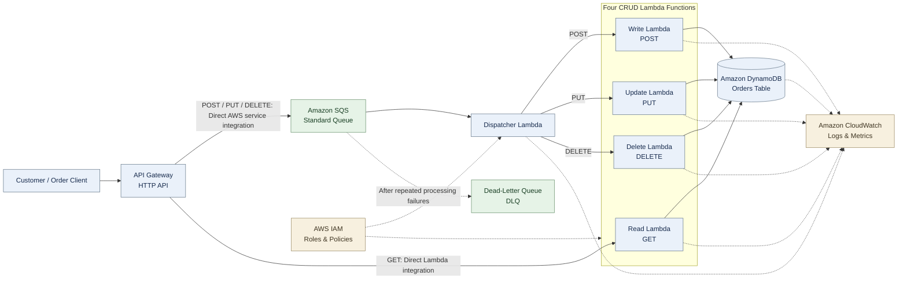

# AWS Order Request Queue & Processing System
## Week 1 — Requirements Analysis and Initial Architecture

**Project:** QuickCart GmbH — Order Request Queue & Processing System  
**Phase:** Week 1 — Architecture and requirements (design only)  
**Implementation approach:** Terraform for AWS infrastructure; IAM roles and policies configured manually in the AWS Console.

---

## 1. Project Overview

QuickCart GmbH needs a reliable way to receive order-related requests and process them even when traffic increases or backend functions are temporarily unavailable. This project proposes an AWS serverless, queue-based architecture using API Gateway, Amazon SQS, AWS Lambda, Amazon DynamoDB, Amazon CloudWatch, and AWS IAM.

The central design rule is that **API Gateway sends POST, PUT, and DELETE requests directly to Amazon SQS, with no Lambda between API Gateway and SQS**. One Dispatcher Lambda consumes the queue and routes these messages to the Write, Update, and Delete Lambdas. **GET requests go directly from API Gateway to the Read Lambda** for an immediate response.

## 2. Business Problem

- Order requests may arrive in bursts.
- Backend processing may temporarily fail.
- Incoming requests should be buffered rather than lost.
- The system needs separate create, read, update, and delete operations.
- The team needs visibility into Lambda executions and database changes.
- The solution should be simple, secure, and cost-conscious.

## 3. Project Goals

1. Receive HTTP requests through Amazon API Gateway.
2. Deliver POST, PUT, and DELETE requests **directly from API Gateway to one Amazon SQS Standard queue**, while routing GET directly to Read Lambda.
3. Process queued messages asynchronously using one Dispatcher Lambda.
4. Route queued requests to the Write, Update, or Delete Lambda; invoke Read Lambda directly for GET requests.
5. Store and manage order records in Amazon DynamoDB.
6. Handle processing failures with retries and a dead-letter queue (DLQ).
7. Monitor all five Lambda functions and database operations using CloudWatch.
8. Apply least-privilege permissions through AWS IAM.

## 4. Functional Requirements

| HTTP method | Message operation | Target Lambda | DynamoDB action |
|---|---|---|---|
| POST | `CREATE` | Write Lambda | Create an order item |
| GET | `READ` | Read Lambda | Read an order item |
| PUT | `UPDATE` | Update Lambda | Update an existing order item |
| DELETE | `DELETE` | Delete Lambda | Delete an order item |

Each SQS message for POST, PUT, or DELETE will include a request ID, HTTP method, order identifier where relevant, and the request data. The Dispatcher Lambda will inspect the method and invoke the appropriate Write, Update, or Delete Lambda. GET requests bypass SQS and invoke Read Lambda directly.

## 5. Non-Functional Requirements

- **Reliability:** SQS buffers messages when processing is delayed.
- **Fault tolerance:** Failed queue messages are retried and eventually moved to the DLQ after repeated failures.
- **Scalability:** SQS and Lambda support variable workloads.
- **Security:** IAM roles follow least-privilege principles.
- **Observability:** CloudWatch tracks Lambda invocations, errors, queue backlog, and custom database-operation counts.
- **Cost control:** Use a small development setup, monitor costs, and avoid optional paid production services in the initial deployment.
- **Data integrity:** Processing must be idempotent because SQS Standard can deliver messages more than once.

## 6. AWS Services and Responsibilities

| AWS service | Responsibility |
|---|---|
| API Gateway (HTTP API) | Public HTTP entry point; sends POST, PUT, and DELETE directly to SQS and GET directly to Read Lambda |
| Amazon SQS Standard Queue | Buffers POST, PUT, and DELETE requests in **one** main queue |
| Dispatcher Lambda | **Only consumer of the main SQS queue**; invokes the correct Write, Update, or Delete Lambda |
| Write Lambda | Creates order records in DynamoDB |
| Read Lambda | Reads order records from DynamoDB |
| Update Lambda | Updates order records in DynamoDB |
| Delete Lambda | Deletes order records from DynamoDB |
| Amazon DynamoDB | Stores order data |
| Amazon CloudWatch | Logs, Lambda invocation/error metrics, queue monitoring, and custom create/update metrics |
| Amazon SQS DLQ | Stores messages that fail repeatedly |
| AWS IAM | Controls permissions for API Gateway, SQS, Lambda, DynamoDB, and CloudWatch |

**Total Lambda functions: five** — one Dispatcher Lambda and four CRUD Lambdas. There is **no Submission Lambda** and **no Lambda between API Gateway and SQS**. Read Lambda is invoked directly by API Gateway for GET requests.

## 7. Initial Architecture Diagram

The diagram follows the original Week 1 layout: the main request flow moves from left to right, with operational services shown below. The four CRUD functions are grouped to keep the design readable.

**Important:** The diagram does **not** contain a Lambda between API Gateway and SQS. API Gateway sends POST, PUT, and DELETE directly to SQS, but GET directly to Read Lambda. Only the Dispatcher Lambda reads messages from the main queue; attaching multiple CRUD Lambdas as competing consumers would not guarantee correct routing.

## 8. Initial Message Flow

1. A customer sends a `POST`, `GET`, `PUT`, or `DELETE` request to API Gateway.
2. For `GET`, API Gateway invokes Read Lambda directly; Read Lambda reads DynamoDB and returns the result through API Gateway.
3. For `POST`, `PUT`, or `DELETE`, API Gateway uses an IAM-authorized **direct SQS integration** to place a structured message on the single main SQS queue.
4. SQS retains the message until it is received by the Dispatcher Lambda event-source mapping.
5. The Dispatcher Lambda reads the method and invokes the matching Write, Update, or Delete Lambda.
6. The selected CRUD Lambda performs the corresponding DynamoDB operation and records relevant logs and metrics in CloudWatch.
7. The Dispatcher acknowledges successful processing by allowing the SQS event-source mapping to delete the message. Failed processing is retried; after the configured threshold, the message is moved to the DLQ.

**Processing note:** The Dispatcher must handle downstream Lambda failures correctly, rather than treating a failed CRUD operation as a successful queue message. Initially, use small batches (for example, batch size 1) to simplify error handling. The dispatcher may invoke CRUD Lambdas synchronously *internally* so it can determine whether processing succeeded; this does **not** make the public API synchronous.

## 9. API Response Limitation and Design Decision

Because **API Gateway → SQS → Lambda is asynchronous**, API Gateway can acknowledge that a POST, PUT, or DELETE request was accepted into the queue, but it **cannot immediately return the final DynamoDB operation result** through this same request path.

For Week 1, **GET is the exception**: API Gateway invokes Read Lambda directly, allowing it to return the DynamoDB read result immediately. POST, PUT, and DELETE remain queued commands. They can return an acceptance response (for example, HTTP `202 Accepted`) and a request ID; retrieving their eventual result or status requires an additional response mechanism to be designed later.

The direct GET integration is a proposed design adjustment and should be confirmed with the instructor before implementation.

## 10. Queue, Retries, and DLQ

- Use **one Amazon SQS Standard queue** for POST, PUT, and DELETE requests; GET bypasses the queue.
- Use **one separate DLQ** for messages that repeatedly fail.
- Configure a redrive policy (initial proposal: `maxReceiveCount = 3`).
- Set the queue visibility timeout appropriately for the Dispatcher Lambda timeout and downstream processing.
- Include a unique request ID and design database operations for safe retries and duplicate deliveries.
- Use structured error logs so DLQ messages can be investigated.

## 11. Monitoring with Amazon CloudWatch

CloudWatch should show:

- Number of invocations and errors for **Dispatcher, Write, Read, Update, and Delete Lambda** individually.
- SQS queue depth, message age, and DLQ message count.
- DynamoDB request failures and throttling indicators.
- **Exact successful create and update counts** through custom metrics emitted by the relevant Lambda functions (rather than assuming built-in DynamoDB metrics directly represent business operations).

A basic CloudWatch dashboard can present these metrics in Week 3 or Week 4.

## 12. Security and IAM

IAM roles and policies will be created **manually in the AWS Console**, as required for this project. Other AWS infrastructure will be managed through Terraform.

- API Gateway needs permission to send POST, PUT, and DELETE messages to the specific SQS queue and permission to invoke Read Lambda for GET.
- Dispatcher Lambda needs permission to receive/delete queue messages, write logs, and invoke Write, Update, and Delete Lambdas.
- Each CRUD Lambda needs only the DynamoDB permissions required for its operation, plus CloudWatch logging and any required metric permissions.
- Avoid broad permissions such as unrestricted `*` resource access when a specific resource ARN can be used.

Lambda functions do not need to be placed in a VPC for basic access to SQS or DynamoDB. VPC networking and endpoints are optional design decisions, not prerequisites for Week 1.

## 13. Week-by-Week Implementation Plan

| Week | Planned work |
|---|---|
| **Week 1** | Requirements analysis, initial architecture, service selection, message-flow design, and risk identification. **No deployment required.** |
| **Week 2** | Terraform setup; SQS and DLQ; DynamoDB table; API Gateway direct SQS integration for POST/PUT/DELETE and direct Read Lambda integration for GET; manually configured IAM; initial Lambda functions. |
| **Week 3** | Connect Dispatcher to SQS; implement four CRUD Lambdas; test queued POST/PUT/DELETE routing, direct GET reads, DynamoDB operations, retries, and DLQ; add CloudWatch metrics. |
| **Week 4** | End-to-end testing, monitoring dashboard, security review, documentation, and presentation. Evaluate optional production improvements. |

### Optional production improvements for Week 4

- **AWS CloudTrail:** Audit AWS API management/control-plane activities; it is **not** automatically a log of every customer HTTP request to API Gateway.
- **DynamoDB Accelerator (DAX):** Optional read cache for suitable workloads; **do not deploy initially**, because it can introduce ongoing charges.
- Additional security, tracing, and result-retrieval design may be considered after the basic system works.

## 14. Risks and Open Questions

| Risk / question | Proposed handling |
|---|---|
| A single SQS queue cannot route queued messages by itself | One Dispatcher Lambda reads the queue and invokes Write, Update, or Delete Lambda |
| SQS may deliver duplicate messages | Use request IDs and idempotent processing |
| Downstream CRUD Lambda fails | Propagate failure to Dispatcher so SQS retries and DLQ redrive can work |
| GET needs an immediate response | API Gateway invokes Read Lambda directly; confirm this exception with the instructor |
| AWS charges exceed expectations | Monitor AWS billing; keep resources small; avoid DAX and unnecessary paid features |
| IAM is not managed by Terraform | Document the manually created roles and policies carefully |

## 15. Week 1 Deliverables and Conclusion

**Week 1 deliverables:**

- Requirements analysis and business goals.
- Initial architecture with **one main SQS queue, one Dispatcher Lambda, four CRUD Lambdas, DynamoDB, CloudWatch, IAM, and a DLQ**.
- A clear end-to-end message-flow explanation.
- Reliability, security, monitoring, and cost considerations.
- An implementation plan for Weeks 2–4.

The proposed architecture connects **API Gateway directly to SQS for POST, PUT, and DELETE**, without a Submission Lambda, while **GET connects directly from API Gateway to Read Lambda**. The Dispatcher Lambda routes queued messages to Write, Update, and Delete Lambdas. The design is ready for instructor review before infrastructure deployment.
