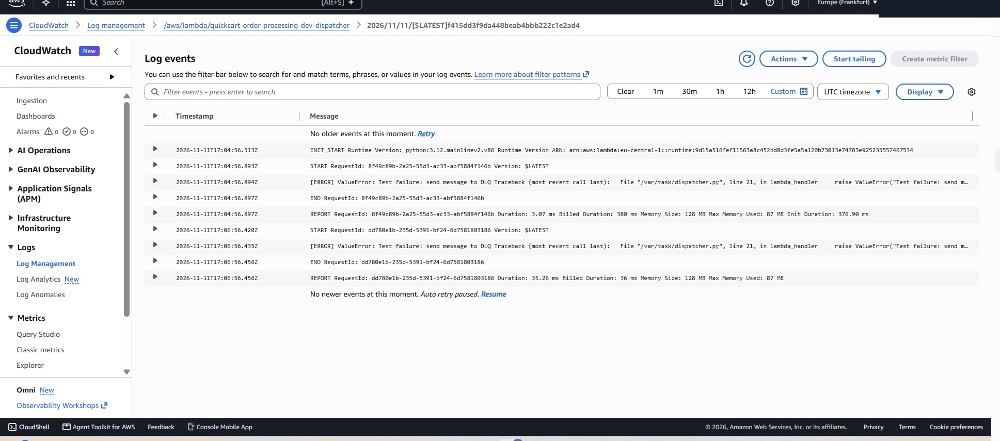
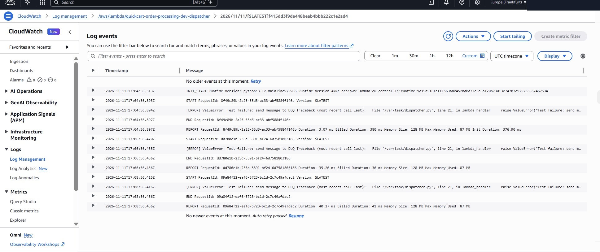
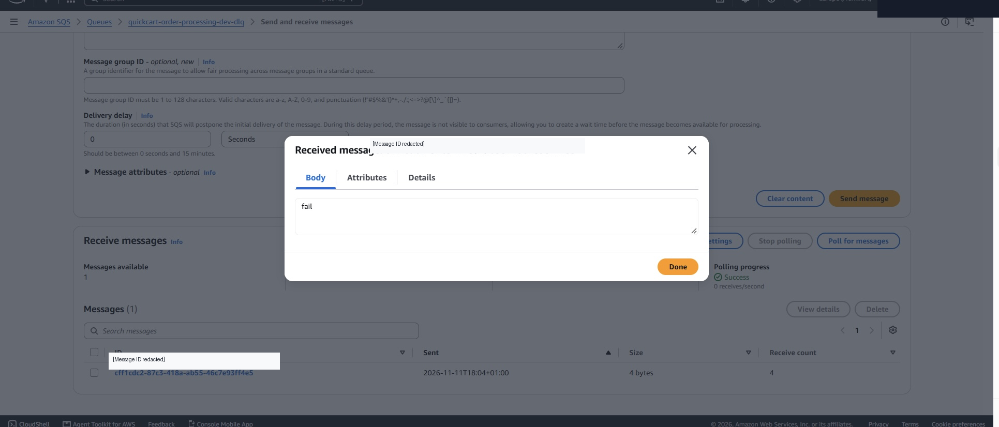
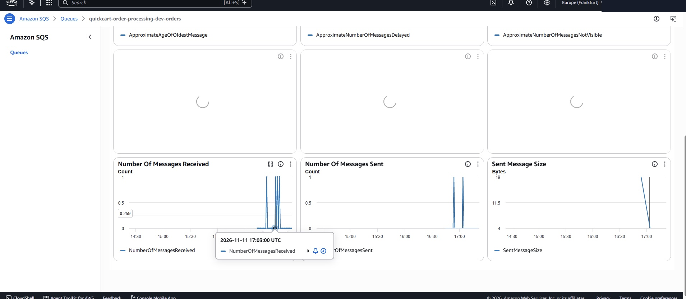
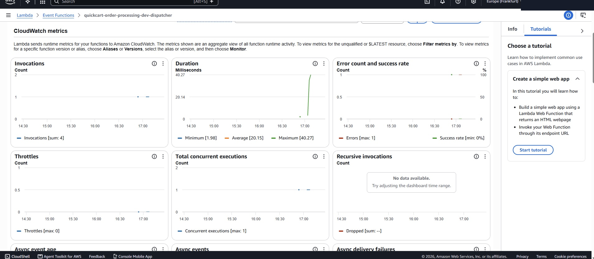

# Week 3 — Failure Handling, Retries, Dead-Letter Queue & Monitoring

**Project:** QuickCart Order Request Queue & Processing System  
**AWS Region:** `eu-central-1` (Frankfurt)  
**Infrastructure as Code:** Terraform  
**Test date:** November 11, 2026  
**Status:** Implemented and tested; AWS resources destroyed after testing to reduce costs

## 1. Objective

Week 3 focused on making the existing asynchronous order-processing system more reliable. The work added controlled failure testing, SQS retries, a dead-letter queue (DLQ), and CloudWatch monitoring without removing the existing API Gateway, Lambda, or DynamoDB components.

## 2. Architecture

**Existing order flow:**

`API Gateway → SQS orders queue → Dispatcher Lambda → Order operation Lambdas → DynamoDB`

The order operation functions include `create_order`, `update_order`, and `delete_order`. A separate `get_order` Lambda supports retrieving orders.

**Failure flow:**

`SQS orders queue → Dispatcher Lambda fails → Message becomes visible again → Retry → DLQ after repeated failures`

The DLQ stores messages that require investigation instead of allowing indefinite retries.

## 3. Terraform Configuration

| Setting | Configured value |
|---|---|
| Main queue | `quickcart-order-processing-dev-orders` |
| Dead-letter queue | `quickcart-order-processing-dev-dlq` |
| SQS visibility timeout | 120 seconds |
| Redrive `maxReceiveCount` | 3 |
| Main queue retention | 345,600 seconds (4 days) |
| DLQ retention | 1,209,600 seconds (14 days) |
| Lambda event-source batch size | 1 |
| Lambda timeout | 15 seconds |
| Lambda runtime | Python 3.12 |

Relevant files:

- `infrastructure/sqs.tf` — queues and redrive policy
- `infrastructure/sqs_trigger.tf` — SQS-to-dispatcher event source mapping
- `infrastructure/lambda.tf` — Lambda configuration and deployment packages
- `lambda/dispatcher.py` — message routing, successful text-message logging, and intentional failure simulation

## 4. Failure Handling Implementation

The dispatcher deliberately raises an exception for the test message `FAIL`, ignoring letter case:

```python
if text.upper() == "FAIL":
    raise ValueError("Test failure: send message to DLQ")
```

For ordinary non-JSON text, the dispatcher logs successful processing. For JSON requests containing supported `POST`, `PUT`, or `DELETE` operations, it invokes the corresponding order Lambda. It also checks for errors returned by those functions.

**Important distinction:** The successful plain-text test demonstrates SQS-to-Lambda processing and logging; it does **not** demonstrate a DynamoDB write.

## 5. Test Results

### Test A — Successful SQS Message

**Input:** `Order 1001 - Laptop`  
**Observed CloudWatch output:**

```text
Message processed successfully: Order 1001 - Laptop
```

**Result:** PASS — the dispatcher received and logged the message.

### Test B — Intentional Failure

**Input:** `fAIL`  
**Observed CloudWatch output:**

```text
[ERROR] ValueError: Test failure: send message to DLQ
```

**Result:** PASS — the Lambda failed as intended, allowing SQS retry behavior to be observed.

### Test C — Retries and DLQ

The failed message was retried and subsequently appeared in `quickcart-order-processing-dev-dlq`.

**Evidence observed in the DLQ:**

- Message body: `fAIL`
- Message size: 4 bytes
- Receive count shown when inspecting the DLQ message: 4 (this includes the DLQ inspection receive and should not be interpreted as four processing attempts)
- DLQ monitoring showed one visible message during the test

**Result:** PASS — the DLQ retained the failed message for inspection.

### Test D — Monitoring

The Lambda monitoring screenshot showed the following values for the selected graph period:

| Metric | Observed value |
|---|---|
| Invocations | Sum: 4 |
| Duration — minimum | 1.98 ms |
| Duration — average | 20.15 ms |
| Duration — maximum | 40.27 ms |
| Errors | Maximum: 1 per displayed metric period |
| Throttles | Maximum: 0 |
| Concurrent executions | Maximum: 1 |

The SQS monitoring page was also used to review message-receive activity. The CloudWatch dispatcher log group was:

`/aws/lambda/quickcart-order-processing-dev-dispatcher`

**Result:** PASS — logs and metrics exposed processing activity and failures.

## 6. Screenshot Evidence

The following images were captured from the actual AWS tests. Upload them to a `screenshots/` folder beside this Markdown file using the names below; GitHub will then display them inline.

### Intentional failure in CloudWatch



### Repeated failure logs / retries



### Failed message retained in the DLQ



### Main SQS queue monitoring



### Lambda metrics



## 7. Reliability Considerations

- **Visibility timeout:** Prevents concurrent consumers from receiving the same message while it is being processed, but a failed message can become visible again.
- **Retries:** Help recover from transient errors, but repeatedly failing messages eventually move to the DLQ.
- **DLQ investigation:** Operators should inspect, correct, and deliberately redrive failed messages when appropriate.
- **Duplicate delivery:** Standard SQS queues provide at-least-once delivery. Production order operations should be idempotent, for example by using unique request identifiers. End-to-end idempotency was not established by this Week 3 test.
- **Monitoring:** CloudWatch logs, Lambda errors/duration, SQS queue activity, and DLQ message counts help detect operational problems.

## 8. Deployment and Cost Cleanup

The Week 3 infrastructure was deployed and tested using Terraform. After the tests, the infrastructure was intentionally removed to avoid leaving unnecessary resources running:

```text
Destroy complete! Resources: 25 destroyed.
```

The Terraform code and captured evidence were retained. Before a new live demonstration, the infrastructure must be recreated with Terraform. Historical CloudWatch logs or other separately managed resources may still exist and should be reviewed for cost.

## 9. Conclusion

Week 3 demonstrated successful SQS-to-Lambda message processing, intentional processing failures, automatic retries, DLQ redrive behavior, and CloudWatch monitoring. The original QuickCart architecture was preserved, and Terraform was used for both deployment and cleanup.
